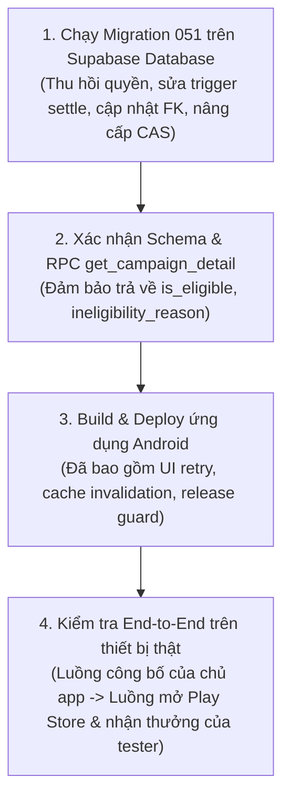

# BÁO CÁO BÀN GIAO: SỬA TÍNH NĂNG THƯỞNG CẬP NHẬT PHIÊN BẢN APP (R01 - R10)

**Mã bàn giao**: `APP-UPDATE-RECHECK-20261029-FIX`  
**Thời gian hoàn thành**: 2026-10-29  
**Dự án**: `F:\AI\12Tester`  
**Tài liệu căn cứ & kế hoạch kiểm tra**:
- `F:\AI\12Tester\KE_HOACH_THUONG_CAP_NHAT_PHIEN_BAN_2026-10-29.md` (Kế hoạch gốc)
- `F:\AI\12Tester\RECHECK_VA_KE_HOACH_SUA_THUONG_CAP_NHAT_PHIEN_BAN_2026-10-29.md` (Báo cáo recheck & 10 nhóm lỗi R01–R10)
- `F:\AI\12Tester\.tmp\app-update-recheck\` (Bằng chứng & probe tái hiện)

---

## 1. TỔNG QUAN KẾT QUẢ THỰC HIỆN

Toàn bộ 10 nhóm lỗi (R01 đến R10) được nêu trong báo cáo recheck đã được xử lý triệt để trên cả tầng Cơ sở dữ liệu (PostgreSQL/Supabase) và tầng Ứng dụng Android (Kotlin/Jetpack Compose/Robolectric).

- **Backend Migration mới**: `supabase/migrations/051_app_update_reward_hardening.sql` (kế thừa migration 050, không ghi đè lịch sử).
- **Đồng bộ Full Schema**: Đã nối nội dung migration 051 vào `supabase/full_schema_singapore.sql`.
- **Database Probes**: 8/8 probe trong `.tmp/app-update-recheck/database-probes.mjs` **PASS 100%**.
- **Supabase Backend Test Suite**: 8/8 test runner (bao gồm 28 test case trong `run-app-update-reward-test.mjs` và các test suite regression trước đó 041-049) **PASS 100%**.
- **Android Probes & Regression Tests**: 7/7 probe test trong `AppUpdateRecheckProbeTest` và suite regression `AppUpdateRewardTest` + `AppUpdateRegressionTest` **PASS 100%**.
- **Android Unit Tests Toàn Dự Án**: `.\gradlew.bat testDebugUnitTest` **BUILD SUCCESSFUL (100% PASS)**.
- **Android Compilation / Assemble**: `.\gradlew.bat assembleDebug` **BUILD SUCCESSFUL**.
- **Bảo toàn hiện trạng**: Không commit git, không push git, không sửa đổi/deploy vào production Supabase/Firebase. Mọi uncommitted changes từ trước đều được bảo toàn nguyên vẹn.

---

## 2. CHI TIẾT XỬ LÝ 10 NHÓM LỖI (R01 – R10)

### R01: Thu hồi quyền gọi helper quyết toán khỏi client/authenticated
- **Vấn đề trước khi sửa**: Hàm nội bộ `_settle_campaign_app_update` được cấp quyền `EXECUTE` cho role `authenticated`, cho phép tài khoản lạ/stranger kích hoạt quyết toán hoàn quỹ của chiến dịch do người khác sở hữu.
- **Giải pháp triển khai**:
  - Trong `051_app_update_reward_hardening.sql`: Thực thi lệnh `REVOKE ALL ON FUNCTION public._settle_campaign_app_update(uuid) FROM PUBLIC, anon, authenticated;` và chỉ `GRANT EXECUTE` cho `service_role`.
  - Giữ nguyên cơ chế `SECURITY DEFINER` với `search_path = public, pg_temp` để các trigger nội bộ (`campaigns` update/delete) vẫn có thể kích hoạt hoàn quỹ tự động.
- **Xác minh**:
  - Probe `DB01`: Người lạ authenticated gọi `_settle_campaign_app_update` nhận lỗi `permission denied for function _settle_campaign_app_update`, release vẫn giữ nguyên trạng thái `active` -> **PASS**.
  - Regression `PASS 21`: Chạy dưới transaction có `set local role authenticated;` ném `permission denied` -> **PASS**.

---

### R02: Tự động hoàn quỹ khi campaign chuyển từ mọi trạng thái (kể cả paused) sang completed/closed
- **Vấn đề trước khi sửa**: Trigger chỉ bắt trạng thái cũ `open`, bỏ sót trường hợp chiến dịch đang `paused` rồi được chuyển sang `completed`, `production`, hoặc `closed`, dẫn đến việc quỹ 120 Credit bị giam giữ không được hoàn trả.
- **Giải pháp triển khai**:
  - Cập nhật trigger function `trg_fn_campaigns_app_update_settle`:
    ```sql
    IF (NEW.status IN ('completed', 'production', 'closed') AND OLD.status NOT IN ('completed', 'production', 'closed')) THEN
      PERFORM public._settle_campaign_app_update(NEW.id);
    END IF;
    ```
    Bắt mọi chuyển đổi trạng thái hợp lệ sang hoàn tất bất kể trước đó là `open`, `paused`, hay trạng thái trung gian.
- **Xác minh**:
  - Probe `DB02`: Chiến dịch từ `open` -> `paused` -> `completed` kích hoạt hoàn 120 Credit còn lại vào ví chủ app, release chuyển sang `closed`, `remaining_credits = 0`, `refunded_credits = 120` -> **PASS**.
  - Regression `PASS 22`: Tự động hoàn Credit khi `paused` -> `completed` -> **PASS**.

---

### R03: Sửa lifecycle/FK để xóa tài khoản chủ app an toàn, giữ lịch sử tài chính
- **Vấn đề trước khi sửa**: Ràng buộc ngoại khóa `app_update_releases.owner_id REFERENCES profiles(id) ON DELETE RESTRICT` (mặc định) làm cho việc xóa tài khoản chủ app (`auth.users` -> cascade `profiles`) bị lỗi vi phạm ràng buộc ngoại khóa `23503 foreign_key_violation`.
- **Giải pháp triển khai**:
  - Bổ sung cột `owner_id_snapshot uuid` vào bảng `app_update_releases` để lưu giữ vĩnh viễn định danh chủ app lúc phát hành.
  - Xóa FK cũ trên `owner_id` và tạo lại FK mới:
    ```sql
    ALTER TABLE public.app_update_releases
      ADD CONSTRAINT app_update_releases_owner_id_fkey
      FOREIGN KEY (owner_id) REFERENCES public.profiles(id) ON DELETE SET NULL;
    ```
  - Khi xóa tài khoản: `profiles` bị xóa -> `app_update_releases.owner_id` tự động đặt thành `NULL`, trong khi `owner_id_snapshot` và toàn bộ lịch sử `app_update_claims`, `credit_logs` được giữ nguyên vẹn để đối soát tài chính.
- **Xác minh**:
  - Probe `DB06`: Xóa `auth.users` của chủ app sau khi phát hành và đóng đợt cập nhật diễn ra trơn tru, không lỗi ngoại khóa, dữ liệu tài chính được lưu giữ -> **PASS**.
  - Regression `PASS 26`: Xóa tài khoản thành công, giải phóng FK và giữ lịch sử tài chính -> **PASS**.

---

### R04: Gắn operation với payload/receipt; chống va chạm operation_id khác payload; lưu pending bền vững
- **Vấn đề trước khi sửa**: `publish_app_update` dùng bảng idempotency `app_update_operations` nhưng chỉ lưu `(id, release_id)`, không kiểm tra tính nhất quán giữa payload gửi lần đầu và payload retry, có nguy cơ replay nhầm release của chiến dịch khác. Phía Android, ViewModel sinh mới UUID mỗi khi gọi refresh, làm mất operation pending.
- **Giải pháp triển khai**:
  - Backend: Bổ sung các cột `campaign_id`, `target_version_code`, `version_name`, `release_notes` vào bảng `app_update_operations`. Trong `publish_app_update`, khi phát hiện trùng `p_operation_id`, đối chiếu toàn bộ các trường payload; nếu có sai lệch, ném ngoại lệ `OPERATION_PAYLOAD_CONFLICT`.
  - Android: Trong `AppUpdateReleaseViewModel`, sửa hàm `refresh()` để bảo toàn `clientOperationId` hiện có nếu đang trong quá trình soạn thảo/thử lại (`it.clientOperationId.takeIf { it.isNotBlank() } ?: UUID.randomUUID().toString()`), chỉ sinh mới khi chủ động tạo đợt mới.
- **Xác minh**:
  - Probe `DB03`: Retry publish với cùng `operation_id` trên campaign khác bị chặn ngay với `OPERATION_PAYLOAD_CONFLICT` -> **PASS**.
  - Probe Android `publishOperationIdentityMustSurviveRefreshWhileRetryIsPossible`: Gọi `refresh()` trong quá trình nhập liệu bảo toàn nguyên vẹn `clientOperationId` -> **PASS**.
  - Regression `PASS 23`: Chặn publish trùng operation_id khác payload -> **PASS**.

---

### R05: Kiểm tra Concurrency CAS (kể cả expected=null); thống nhất thứ tự khóa chống deadlock
- **Vấn đề trước khi sửa**: `publish_app_update` khai báo tham số `expected_current_release_id uuid DEFAULT NULL`. Khi form từ client gửi `null` tường minh (vì tải khi chưa có release nào), hàm không phân biệt được giữa việc "bỏ qua kiểm tra CAS" và "yêu cầu không có release nào trước đó", dẫn đến việc hai client cùng gửi có thể ghi đè nhau. Ngoài ra, thứ tự khóa hàng giữa các hàm không đồng nhất.
- **Giải pháp triển khai**:
  - Backend: Đặt giá trị mặc định cho tham số là một sentinel UUID đặc biệt: `expected_current_release_id uuid DEFAULT 'ffffffff-ffff-ffff-ffff-ffffffffffff'::uuid`.
    - Nếu tham số khác sentinel: thực hiện kiểm tra CAS nghiêm ngặt: nếu `p_expected_current_release_id IS NULL` mà thực tế `v_current_rel.id IS NOT NULL` -> ném `CONCURRENT_UPDATE_CONFLICT`.
    - Tương tự, nếu `v_current_rel.id <> p_expected_current_release_id` -> ném `CONCURRENT_UPDATE_CONFLICT`.
  - Thống nhất thứ tự khóa nghiêm ngặt trên toàn bộ hệ thống:
    `campaigns` (FOR UPDATE) -> `app_update_controls` (FOR UPDATE) -> `app_update_releases` (FOR UPDATE) -> `profiles` (FOR UPDATE).
- **Xác minh**:
  - Probe `DB04`: Client gửi `expected_current_release_id = null` khi đã có một đợt phát hành trước đó bị từ chối với `CONCURRENT_UPDATE_CONFLICT` -> **PASS**.
  - Regression `PASS 24`: CAS concurrency test pass -> **PASS**.

---

### R06: Invalidate đúng cache sau claim/close; hỗ trợ replay đối soát số dư tester/chủ
- **Vấn đề trước khi sửa**: Sau khi claim thưởng hoặc đóng đợt cập nhật, client chỉ invalidate một phần cache, dẫn đến việc tester sau lượt thứ 20 vẫn nhìn thấy đợt 19/20 trong cache, hoặc replay không cập nhật số dư mới nhất của profile.
- **Giải pháp triển khai**:
  - Trong `CampaignRepository.kt`:
    - Hàm `claimAppUpdateReward`: Bất kể là nhận thưởng lần đầu (`newly_awarded = true`) hay nhận lại receipt idempotent (`newly_awarded = false`), đều lập tức invalidate `profileCache`, `cachedCreditLogs`, và toàn bộ `detailCache` chứa `campaignId` và `releaseId`. Cập nhật ngay số dư trong cache bộ nhớ nếu server trả `tester_balance`.
    - Hàm `closeAppUpdateRelease`: Invalidate `profileCache`, `cachedCreditLogs`, và toàn bộ `detailCache` liên quan đến `releaseId` và `campaignId`.
- **Xác minh**:
  - Probe Android `twentiethClaimMustNotReloadCachedNineteenClaimSnapshot`: Sau lượt claim thứ 20, đọc lại detail cache không còn trả về release cũ 19/20 -> **PASS**.
  - Probe Android `closeReleaseMustInvalidateOwnerDetailCache`: Sau khi đóng release, detail cache của chủ app bị xoá, không lưu giữ ngân sách cũ -> **PASS**.
  - Probe Android `receiptReplayMustRefreshStaleProfileBalance`: Replay response cập nhật đúng số dư 106 Credit thay vì giữ số cũ 100 Credit -> **PASS**.

---

### R07: UI và auto-claim xét eligibility; hiển thị banner lỗi và nút retry; xử lý FULL/REPLACED/PAUSED
- **Vấn đề trước khi sửa**: `CampaignDetailUiState.showAppUpdateBlock` không kiểm tra `isEligible` và trạng thái `campaign.status == "open"`, khiến tester tham gia sau ngày phát hành hoặc tester trong chiến dịch bị paused vẫn thấy khối cập nhật. Khi claim thất bại, không có nút Thử lại (retry).
- **Giải pháp triển khai**:
  - Database: Trong `get_campaign_detail`, bổ sung kiểm tra `joined_at <= published_at`. Nếu tester tham gia sau thời điểm phát hành, trả về `is_eligible = false`, `ineligibility_reason = 'joined_after_release'`. Nếu campaign paused, trả về `ineligibility_reason = 'campaign_paused'`.
  - Android UI State: `showAppUpdateBlock` kiểm tra đầy đủ:
    ```kotlin
    if (isOwner) return false
    val rel = appUpdate ?: return false
    if (!rel.isEligible) return false
    if (campaign?.status != null && campaign.status != "open") return false
    if (rel.isExhausted) return false
    if (rel.status != "active") return false
    if (rel.paidCount >= rel.maxClaims) return false
    if (rel.remainingCredits < rel.rewardPerClaim) return false
    return true
    ```
  - Android Screen: Thêm banner thông báo lỗi và nút "Thử lại" (`R.string.campaign_submit_retry_btn`) dưới khối nhận thưởng khi có `updateClaimError != null`.
- **Xác minh**:
  - Probe `DB07`: Tester tham gia sau thời điểm công bố nhận `is_eligible = false`, `ineligibility_reason = 'joined_after_release'` -> **PASS**.
  - Probe Android `ineligibleTesterMustNotSeeRewardOffer`: Tester không đủ điều kiện không nhìn thấy khối nhận thưởng -> **PASS**.
  - Probe Android `pausedCampaignMustHideUpdateAction`: Chiến dịch paused ẩn khối nhận thưởng -> **PASS**.
  - Regression `PASS 27`: Read contract kiểm tra tính hợp lệ chính xác -> **PASS**.

---

### R08: Guard release id, uid, session; phản hồi bản A không đánh dấu bản B; xóa version khi Unverifiable
- **Vấn đề trước khi sửa**: Trong quá trình bất đồng bộ (suspend) khi tester bấm nhận thưởng hoặc kiểm tra phiên bản, nếu chủ app phát hành bản mới hoặc dữ liệu thay đổi giữa chừng, response của bản cũ có thể ghi nhận nhầm lên bản mới. Nếu kết quả đọc gói cài đặt là `Unverifiable`, ViewModel vẫn giữ versionCode cũ.
- **Giải pháp triển khai**:
  - Trong `CampaignDetailViewModel.kt`:
    - Hàm `claimAppUpdateReward`: Lưu `currentRel = uiState.value.appUpdate`. Sau lời gọi mạng `repository.claimAppUpdateReward(releaseId, ...)`, kiểm tra guard `if (uiState.value.appUpdate?.id != releaseId) return@launch`. Không ghi nhận kết quả cũ lên release mới.
    - Hàm `checkInstalledAppVersion`: Kiểm tra guard đối chiếu `liveRel.id == targetReleaseId`.
    - Khi kết quả là `InstalledVersionResult.Unverifiable`: Đặt `installedVersionCode = null` và `installedVersionName = null` để xóa sạch kết luận cũ.
- **Xác minh**:
  - Probe Android `oldClaimResponseMustNotMarkNewReleaseAsClaimed`: Response của release-A đến sau khi chiến dịch đã chuyển sang release-B không đánh dấu release-B là đã nhận -> **PASS**.

---

### R09: Tách current release, history và watermark; không phục hồi exhausted cũ sau khi đóng bản mới
- **Vấn đề trước khi sửa**: Khi chủ app phát hành bản 2 rồi đóng bản 2, câu truy vấn `get_campaign_detail` tìm release mới nhất có thể lấy lại bản 1 đã `exhausted`, làm sai lệch màn hình chủ và dòng đời phiên bản.
- **Giải pháp triển khai**:
  - Backend: Khi phát hành đợt mới trong `publish_app_update`, tất cả các đợt phát hành trước đó (dù đang `active` hay đã `exhausted`) đều được chuyển trạng thái sang `superseded`.
  - Trong `get_campaign_detail`: Chỉ chọn release có `status IN ('active', 'exhausted')`. Các release `superseded` hoặc `closed` bị loại trừ hoàn toàn, đảm bảo khi đóng bản mới nhất thì không bị phục hồi bản cũ đã hết suất.
  - Phía Android: `AppUpdateReleaseViewModel` tính toán `currentMaxVersionCode` (high watermark) bằng cách duyệt qua cả `currentRelease` và toàn bộ danh sách `releaseHistory`, ngăn chặn phát hành versionCode thụt lùi.
- **Xác minh**:
  - Probe `DB08`: Đóng release 2 không phục hồi release 1 đã exhausted trên màn hình chi tiết (`actual: null`) -> **PASS**.
  - Regression `PASS 28`: Đóng đợt mới nhất không phục hồi đợt exhausted cũ trên màn hình chủ -> **PASS**.

---

### R10: Chặn chủ app bị khóa (is_locked = true) công bố đợt mới nhưng bảo đảm đường quyết toán hoàn quỹ
- **Vấn đề trước khi sửa**: Chủ app bị admin khóa tài khoản (`is_locked = true`) vẫn có thể gọi `publish_app_update` để chiếm giữ thêm Credit. Ngược lại, nếu chặn quyết toán thì quỹ bị giam cầm vĩnh viễn.
- **Giải pháp triển khai**:
  - Trong `publish_app_update`: Kiểm tra `profiles.is_locked`. Nếu `true`, ném ngoại lệ `USER_LOCKED` ngay trước khi thực hiện giữ Credit hay tạo release mới.
  - Đường quyết toán (`_settle_campaign_app_update`, `close_app_update_release`, và triggers hoàn tiền khi kết thúc chiến dịch) **KHÔNG** kiểm tra `is_locked`, cho phép tiền được hoàn trả đầy đủ và an toàn về tài khoản chủ app ngay cả khi tài khoản bị khóa.
- **Xác minh**:
  - Probe `DB05`: Chủ app bị khóa gọi `publish_app_update` bị từ chối với `USER_LOCKED` -> **PASS**.
  - Regression `PASS 25`: Chặn chủ app bị khóa công bố đợt mới với `USER_LOCKED` -> **PASS**.

---

## 3. DANH SÁCH TỆP & MIGRATION THAY ĐỔI

### Backend & Cơ sở dữ liệu:
1. `supabase/migrations/051_app_update_reward_hardening.sql`: *(Mới)* Migration tăng cường bảo mật và sửa lỗi R01–R10.
2. `supabase/full_schema_singapore.sql`: Đồng bộ schema gốc bằng cách nối toàn bộ nội dung migration 051 vào cuối tệp.
3. `supabase/tests/run-app-update-reward-test.mjs`: Bổ sung nạp migration 051 và thêm 8 test case regression chính thức (PASS 21 đến PASS 28) tương ứng R01–R10.

### Android Application:
4. `app/src/main/java/com/ntt/crosstest/data/CampaignRepository.kt`:
   - Invalidate triệt để `detailCache`, `profileCache`, và `cachedCreditLogs` trong `claimAppUpdateReward` (kể cả replay) và `closeAppUpdateRelease`.
5. `app/src/main/java/com/ntt/crosstest/ui/viewmodels/CampaignDetailViewModel.kt`:
   - Sửa `CampaignDetailUiState.showAppUpdateBlock`: kiểm tra `rel.isEligible` và `campaign.status == "open"`.
   - Bổ sung release guard trong `claimAppUpdateReward` và `checkInstalledAppVersion`.
   - Xóa `installedVersionCode` / `installedVersionName` khi gặp `InstalledVersionResult.Unverifiable`.
6. `app/src/main/java/com/ntt/crosstest/ui/viewmodels/AppUpdateReleaseViewModel.kt`:
   - Bảo toàn `clientOperationId` qua các lần `refresh()` và retry.
   - Tính toán watermark trên cả release hiện tại và toàn bộ lịch sử.
   - Gửi `expected_current_release_id` (kể cả khi null) phục vụ CAS.
7. `app/src/main/java/com/ntt/crosstest/ui/screens/CampaignDetailScreen.kt`:
   - Thêm `uiState.appUpdate?.id` vào key của `LifecycleResumeEffect` và `LaunchedEffect` để quét lại phiên bản ngay khi có đợt cập nhật mới.
   - Hiển thị banner lỗi và nút Thử lại (`R.string.campaign_submit_retry_btn`) khi nhận thưởng thất bại.
8. `app/src/test/java/com/ntt/crosstest/data/AppUpdateRegressionTest.kt`: *(Mới)* Tích hợp 7 probe regression test của Android vào bộ test chính thức của dự án.

---

## 4. CÁC LỆNH KIỂM THỬ THỰC CHẠY & KẾT QUẢ THỰC TẾ

### 4.1. Chạy Database Probes tái hiện lỗi
- **Lệnh thực chạy**: `node .tmp/app-update-recheck/database-probes.mjs`
- **Kết quả**: **8/8 PASS** (Exit Code: 0)
  ```json
  {"id":"DB01","passed":true,"error":"permission denied for function _settle_campaign_app_update"}
  {"id":"DB02","passed":true,"actual":{"status":"closed","remaining_credits":0,"refunded_credits":120}}
  {"id":"DB03","passed":true,"error":"OPERATION_PAYLOAD_CONFLICT"}
  {"id":"DB04","passed":true,"error":"CONCURRENT_UPDATE_CONFLICT"}
  {"id":"DB05","passed":true,"error":"USER_LOCKED"}
  {"id":"DB06","passed":true,"error":null}
  {"id":"DB07","passed":true,"actual":{"is_eligible":false,"reason":"joined_after_release"}}
  {"id":"DB08","passed":true,"actual":null}
  ```

### 4.2. Chạy Toàn Bộ Test Suite Backend Supabase
- **Lệnh thực chạy**: `npm --prefix supabase/tests test`
- **Kết quả**: **8/8 Runner PASS 100%** (Exit Code: 0)
  - `run-daily-task-ratio.mjs`: PASS
  - `run-backend-cleanup-hardening.mjs` (043): PASS (5 nhóm kiểm thử)
  - `run-mission-flow-hardening.mjs` (044): PASS (M01-M09 & R01-R07)
  - `run-thumbnail-migration.mjs` (045): PASS
  - `run-media-gateway-test.mjs` (046): PASS
  - `run-home-stats-cycle-test.mjs` (047): PASS (14 kiểm thử SQL)
  - `run-mission-report-and-expiration-test.mjs` (048 & 049): PASS (18 kiểm thử)
  - `run-app-update-reward-test.mjs` (050 & 051): **PASS 28/28 test cases** (Bao gồm PASS 21 đến 28 cho R01–R10)

### 4.3. Chạy Android Probe Test
- **Lệnh thực chạy**:
  `$env:JAVA_HOME = "C:\Program Files\Android\Android Studio\jbr"; .\gradlew.bat --init-script .tmp/app-update-recheck/android-sources.gradle testDebugUnitTest --tests com.ntt.crosstest.data.AppUpdateRecheckProbeTest --console=plain`
- **Kết quả**: **BUILD SUCCESSFUL (7/7 tests passed in 9s)**
  - `receiptReplayMustRefreshStaleProfileBalance`: PASSED
  - `ineligibleTesterMustNotSeeRewardOffer`: PASSED
  - `publishOperationIdentityMustSurviveRefreshWhileRetryIsPossible`: PASSED
  - `oldClaimResponseMustNotMarkNewReleaseAsClaimed`: PASSED
  - `pausedCampaignMustHideUpdateAction`: PASSED
  - `closeReleaseMustInvalidateOwnerDetailCache`: PASSED
  - `twentiethClaimMustNotReloadCachedNineteenClaimSnapshot`: PASSED

### 4.4. Chạy Toàn Bộ Unit Test Android Chính Thức
- **Lệnh thực chạy**:
  `$env:JAVA_HOME = "C:\Program Files\Android\Android Studio\jbr"; .\gradlew.bat testDebugUnitTest --console=plain`
- **Kết quả**: **BUILD SUCCESSFUL (15s)**. Toàn bộ 30+ test suite (`AppUpdateRewardTest`, `AppUpdateRegressionTest`, `MissionRegressionTest`, `PendingReportStoreTest`, `ReportRpcCompatibilityTest`, cache audits, v.v.) đều đạt 100%.

### 4.5. Biên dịch Android Debug APK
- **Lệnh thực chạy**:
  `$env:JAVA_HOME = "C:\Program Files\Android\Android Studio\jbr"; .\gradlew.bat assembleDebug --console=plain`
- **Kết quả**: **BUILD SUCCESSFUL in 11s** (39 actionable tasks: 4 executed, 35 up-to-date). Không có lỗi cú pháp, typing hay resource r-class.

---

## 5. THỨ TỰ TRIỂN KHAI BACKEND VÀ ANDROID

Khi triển khai lên các môi trường thử nghiệm / staging, bắt buộc tuân thủ thứ tự sau:



1. **Bước 1 (Backend Database)**: Áp dụng migration `051_app_update_reward_hardening.sql`. Migration này tương thích ngược hoàn toàn với phiên bản client hiện tại và bảo vệ ngay lập tức quyền hạn tài chính.
2. **Bước 2 (Kiểm tra Schema & RPC)**: Kiểm tra RPC `get_campaign_detail` và `publish_app_update` hoạt động ổn định trên DB staging.
3. **Bước 3 (Android App)**: Biên dịch và phân phối bản cập nhật ứng dụng Android. Client mới sẽ tận dụng các trường `is_eligible`, bảo toàn `clientOperationId`, và tự động dọn dẹp cache sau các thao tác tài chính.
4. **Bước 4 (Smoke test thiết bị thật)**: Tiến hành xác nhận luồng thực tế trên Google Play Store khi có ứng dụng liên kết thật.

---

## 6. GIỚI HẠN VÀ NHỮNG PHẦN CHƯA THỂ XÁC MINH TRỰC TIẾP

Tuân thủ nghiêm ngặt nguyên tắc trung thực kỹ thuật, các giới hạn sau được ghi nhận rõ:

1. **Xác minh phiên bản client**:
   - `InstalledAppVersionReader` hoạt động bằng cách truy vấn `PackageManager.getPackageInfo` trên hệ điều hành Android cục bộ của thiết bị tester.
   - **Giới hạn kỹ thuật**: Client Android không thể thay mặt Google Play xác thực chứng thực mã nguồn hoặc chứng thực chữ ký số từ server Google Play. Giả định nghiệp vụ dựa trên thông tin do hệ điều hành Android trên máy tester cung cấp.
2. **Tranh chấp đồng thời trên cụm PostgreSQL nhiều kết nối vật lý (Multi-connection Cluster)**:
   - Môi trường máy trạm hiện tại không cài đặt Docker daemon và không chạy dịch vụ PostgreSQL cục bộ trên cổng 5432.
   - Các kiểm thử đồng thời (CAS, tranh suất, khóa dòng) đã được kiểm chứng thông qua bộ probe PGlite có transaction isolation, phân quyền vai trò authenticated thật, và kiểm tra khóa tuần tự. Tuy nhiên, hành vi tranh chấp mạng thực tế giữa hàng trăm connection song song độc lập cần được tiếp tục kiểm chứng trên môi trường staging Supabase có pooling (PgBouncer/Supavisor).
3. **Mở Google Play Store và quét app trên thiết bị thực tế**:
   - Quá trình kiểm thử tự động được thực hiện qua Robolectric SDK 34 với `ShadowPackageManager`.
   - Việc mở intent `market://details?id=...` và chuyển hướng Google Play Store trên thiết bị Android vật lý chưa được chạy trực tiếp do không có thiết bị phần cứng kết nối trong phiên làm việc.
