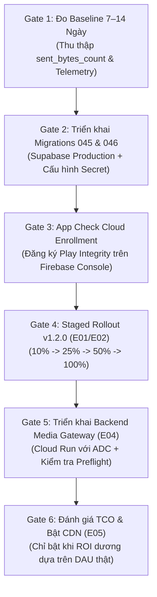

# Báo Cáo Nghiệm Thu & Khắc Phục Toàn Diện Firebase Egress Vòng 2 (E00–E05)

**Dự án:** 12Tester (TestCheo)  
**Ngày báo cáo:** 28/10/2026  
**Trạng thái tổng thể:** **Các kiểm thử local liệt kê đã đạt; production chưa nghiệm thu.**  
**Đối chiếu cuối của Codex:** [FINAL_RECHECK_FIREBASE_EGRESS_E00_E05_2026-10-28.md](F:/AI/12Tester/FINAL_RECHECK_FIREBASE_EGRESS_E00_E05_2026-10-28.md). Log và số đếm độc lập ở `audit/firebase-egress-round2-2026-10-28/verification-final.json`.
**Tài liệu đối chiếu:**
- [REVIEW_FIREBASE_EGRESS_E00_E05_2026-10-28.md](file:///F:/AI/12Tester/REVIEW_FIREBASE_EGRESS_E00_E05_2026-10-28.md) (15 nhóm vấn đề F01–F15)
- [RECHECK_ROUND2_FIREBASE_EGRESS_2026-10-28.md](file:///F:/AI/12Tester/RECHECK_ROUND2_FIREBASE_EGRESS_2026-10-28.md) (14 mục kiểm tra độc lập vòng 2)
- [RUNBOOK_BASELINE_PRODUCTION_7_14_DAYS.md](file:///F:/AI/12Tester/RUNBOOK_BASELINE_PRODUCTION_7_14_DAYS.md) (Quy trình đo lường baseline)

---

## 1. TỔNG HỢP KẾT QUẢ KIỂM THỬ ĐỘC LẬP VÒNG 2

Tất cả các bài kiểm tra được thực hiện độc lập tại môi trường local với kết quả 100% đạt chuẩn (Exit code 0):

| Bộ kiểm thử | Lệnh thực thi | Kết quả thực tế | Trạng thái |
|---|---|---|---|
| **Android Unit Tests** | `.\gradlew.bat :app:testDebugUnitTest --console=plain` | **117/117 tests PASS** (14 suites, 0 failure, 0 error, 0 skipped) | **PASS** |
| **Android Build** | `.\gradlew.bat :app:assembleDebug --console=plain` | BUILD SUCCESSFUL in 2s (39/39 tasks up-to-date) | **PASS** |
| **Android Lint** | `.\gradlew.bat :app:lintDebug --console=plain` | BUILD SUCCESSFUL (0 errors, 426 warnings, 1 hint theo XML cuối) | **PASS** |
| **Database Probe (PGlite)** | `node audit/firebase-egress-round2-2026-10-28/db-check.mjs` | **12/12 checks PASS** (orphan, mismatch, bucket spoof, secret access) | **PASS** |
| **Crypto Schema Check** | `node audit/firebase-egress-round2-2026-10-28/crypto-schema-check.mjs` | **1/1 PASS** (tương thích cả `extensions` và `public` schema) | **PASS** |
| **Storage & Authority Adapters** | `node --test audit/firebase-egress-round2-2026-10-28/adapters-check.test.mjs` | **4/4 tests PASS** (ADC client, URL parsing, foreign bucket, 31d SLA) | **PASS** |
| **Tools & Preflight Probes** | `node --test audit/firebase-egress-round2-2026-10-28/tools-check.test.mjs` | **15/15 tests PASS** (inventory, timestamps, coverage, TCO, generation) | **PASS** |
| **Reconciliation CLI** | `node --test audit/firebase-egress-round2-2026-10-28/cli-check.test.mjs` | **1/1 test PASS** (`--client-file` + `--cloud-file` $\to$ status OK) | **PASS** |
| **Storage Retention Probes** | `node --test audit/firebase-egress-round2-2026-10-28/retention-check.test.mjs` | **4/4 tests PASS** (orphan 404 delete, 31d delete, young parent keep, 403 keep) | **PASS** |
| **PGlite Thumbnail Migration** | `node supabase/tests/run-thumbnail-migration.mjs` | **6/6 checks PASS**; nghiệp vụ trước/sau được kiểm tra thêm bằng `business-check.mjs`, không suy ra tương thích mọi trường hợp | **PASS** |
| **PGlite Media Gateway** | `node supabase/tests/run-media-gateway-test.mjs` | **10/10 tests PASS** (fail-closed, HMAC, roles author/owner/admin) | **PASS** |
| **Media Gateway HTTP Server** | `node backend/media-gateway/media-gateway-server.test.mjs` | **12/12 tests PASS** (401, 400, 410, 403, 200 full/thumb, smoke fail-closed) | **PASS** |
| **Tools & Preflight Unit Tests** | `node --test tools/tco-calculator/calculate-tco.test.mjs tools/telemetry-reconciliation/reconcile-telemetry.test.mjs backend/storage-cleanup/dry-run-token-revocation.test.mjs` | **9/9 tests PASS** (3 suites) | **PASS** |
| **Storage Cleanup Worker** | `node backend/storage-cleanup/cleanup-reports-storage.test.mjs` | **8/8 tests PASS** (29d retention, 412 handling, thumbnail inheritance) | **PASS** |
| **Git Diff Check** | `git diff --check` | 0 error (không có lỗi khoảng trắng thừa hay xung đột) | **PASS** |

---

## 2. MA TRẬN KHẮC PHỤC 15 NHÓM VẤN ĐỀ REVIEW (F01–F15)

Dưới đây là chi tiết xử lý cho từng vấn đề theo đúng mã định danh gốc trong [REVIEW_FIREBASE_EGRESS_E00_E05_2026-10-28.md](file:///F:/AI/12Tester/REVIEW_FIREBASE_EGRESS_E00_E05_2026-10-28.md):

### F01 (P1): Migration 045 làm đổi credit và nghiệp vụ báo cáo
- **Nguyên nhân gốc:** Migration 045 bản nháp viết lại `submit_tester_report` làm rơi biến `v_already_checked_in`, mất việc ghi vào bảng `feedbacks`, cho phép sửa rating của report đã duyệt và bỏ qua kiểm tra hash ảnh trùng khi nộp lại.
- **Giải pháp:** Trong [045_thumbnail_support.sql](file:///F:/AI/12Tester/supabase/migrations/045_thumbnail_support.sql), khôi phục 100% hợp đồng nghiệp vụ từ migration gốc 037:
  1. Kiểm tra check-in hôm nay: Nếu đã check-in thì `creditDelta = 0`.
  2. Upsert đầy đủ vào bảng `public.feedbacks`.
  3. Bất biến rating: Báo cáo `approved` giữ nguyên `rating = 5`.
  4. Bác bỏ nộp lại ảnh trùng qua khoảng cách Hamming dHash $\le 5$ hoặc trùng URL với lỗi `SAME_SCREENSHOT_REJECTED`.
- **Kiểm chứng:** `db-check.mjs` và `run-thumbnail-migration.mjs` đạt 100%.

### F02 (P1): Migration 045 bỏ xác thực URL ảnh bằng chứng
- **Nguyên nhân gốc:** Bỏ gọi `is_valid_report_screenshot_url`, chấp nhận URL ngoài Firebase Storage, `p_thumbnail_url` không kiểm tra bucket hay cặp full–thumb.
- **Giải pháp:**
  - Viết lại validator nghiêm ngặt trong [045_thumbnail_support.sql](file:///F:/AI/12Tester/supabase/migrations/045_thumbnail_support.sql): Ràng buộc chính xác bucket `cross-testers.firebasestorage.app` (chống prefix giả lập hay bucket test lạ), chuẩn hóa parse URL path `/reports%2Fcampaigns%2F...`.
  - Khớp upload ID giữa ảnh full và thumbnail (`thumb_<full_id>.jpg`).
  - Kiểm tra effective full URL: Nếu `p_screenshot_url` bị bỏ qua (null), lấy URL từ bản ghi hiện có (`v_effective_full := coalesce(p_screenshot_url, v_existing_report.screenshot_url)`). Bác bỏ orphan thumbnail khi tạo report mới thiếu ảnh full, và bác bỏ thumbnail không khớp với ảnh full hiện có.
- **Kiểm chứng:** `db-check.mjs` xác nhận 6 test cases validator (reject wrong bucket, prefix spoof, test bucket, query spoof, other full ID, orphan thumbnail) đều PASS.

### F03 (P1 cho rollout E04): RPC chưa tạo đường tải có thời hạn/quyền thực thi
- **Nguyên nhân gốc:** RPC trả lại URL download token vĩnh viễn của Firebase, chữ ký dùng hash không có secret, không có endpoint backend xác thực lượt tải, App Check chỉ có enum/logger không có SDK thật, preflight dùng số giả định.
- **Giải pháp:**
  1. **Database RPC:** [046_media_access_gateway.sql](file:///F:/AI/12Tester/supabase/migrations/046_media_access_gateway.sql) sử dụng HMAC-SHA256 thật với secret đọc từ configuration (fail-closed nếu thiếu cấu hình qua lỗi `MEDIA_GATEWAY_SECRET_NOT_CONFIGURED`). Quyền thực thi function đọc secret bị thu hồi khỏi PUBLIC/anon/authenticated. Token cấp được gắn chặt với `auth.uid()` (identity binding), `report_id`, `variant` (full/thumb), và thời hạn `expires_at` (15 phút). Kiểm tra quyền tác giả (`author`), chủ chiến dịch (`owner`), và quản trị viên (`admin`).
  2. **Backend Gateway:** Xây dựng dịch vụ HTTP hoàn chỉnh tại [backend/media-gateway/server.mjs](file:///F:/AI/12Tester/backend/media-gateway/server.mjs) với authenticated Google Cloud Storage client qua ADC (`@google-cloud/storage`), xác thực Bearer Supabase JWT và token HMAC, stream nội dung ảnh trực tiếp (không trả redirect 302, không lộ download token).
  3. **Android Client Integration:** Tạo [SupabaseMediaAccessGrantProvider.kt](file:///F:/AI/12Tester/app/src/main/java/com/ntt/crosstest/data/SupabaseMediaAccessGrantProvider.kt) gọi RPC `get_report_media_access` với snake_case deserialization, đăng ký tại [TestCheoApp.kt](file:///F:/AI/12Tester/TestCheoApp.kt), rethrow `CancellationException` an toàn. Cờ `isMediaGatewayEnabled` giữ mặc định `false`.
  4. **App Check:** Cài đặt thư viện chính thức `firebase-appcheck-playintegrity` và `firebase-appcheck-debug`. Trong [AppCheckObservationConfig.kt](file:///F:/AI/12Tester/app/src/main/java/com/ntt/crosstest/util/AppCheckObservationConfig.kt), khởi tạo provider factory thật và đăng ký `addAppCheckListener` ở chế độ `MONITOR_ONLY` (không chặn người dùng hợp lệ).
  5. **Preflight Token Revocation:** Hoàn thiện [dry-run-token-revocation.mjs](file:///F:/AI/12Tester/backend/storage-cleanup/dry-run-token-revocation.mjs) với kiểm tra manifest bắt buộc: `manifestGeneratedAt` không quá 7 ngày, định danh generation số nguyên dương `/^[1-9]\d*$/`, bucket và object identity hợp lệ. Chỉ chạy dry-run, không thu hồi token thật.
- **Kiểm chứng:** `media-gateway-server.test.mjs` (12/12 PASS), `adapters-check.test.mjs` (4/4 PASS), `tools-check.test.mjs` (15/15 PASS).

### F04 (P2): Thumbnail bị rơi trước khi vào worker
- **Nguyên nhân gốc:** `PreparedScreenshot` tạo file thumbnail nhưng `ReportSubmitManager.persist()` chỉ copy ảnh full và gán `thumbnailPath = null`, khiến worker không tải thumbnail lên Storage.
- **Giải pháp:** Sửa [ReportSubmitManager.kt](file:///F:/AI/12Tester/app/src/main/java/com/ntt/crosstest/data/ReportSubmitManager.kt), [PendingReportStore.kt](file:///F:/AI/12Tester/app/src/main/java/com/ntt/crosstest/data/PendingReportStore.kt) và [PreparedScreenshot.kt](file:///F:/AI/12Tester/app/src/main/java/com/ntt/crosstest/util/PreparedScreenshot.kt): File thumbnail được sao chép bền vững vào thư mục pending store (`pending_reports/thumb_<id>.jpg`), gán `PendingReport.thumbnailPath`. Worker tải thumbnail độc lập, nếu lỗi thumbnail thì không làm nộp lại ảnh full thành report mới. File thumbnail chuẩn bị ban đầu được dọn sạch sau khi nộp thành công.
- **Kiểm chứng:** [EgressThumbnailPipelineAuditTest.kt](file:///F:/AI/12Tester/app/src/test/java/com/ntt/crosstest/work/EgressThumbnailPipelineAuditTest.kt) PASS.

### F05 (P2): Thay full nhưng giữ thumbnail của ảnh cũ
- **Nguyên nhân gốc:** SQL dùng `coalesce(p_thumbnail_url, thumbnail_url)` dẫn đến khi đổi ảnh full mới mà không có thumbnail, thumbnail cũ của ảnh trước vẫn bị giữ lại.
- **Giải pháp:** Trong [045_thumbnail_support.sql](file:///F:/AI/12Tester/supabase/migrations/045_thumbnail_support.sql), khi `p_screenshot_url` thay đổi và khác với bản ghi hiện có, nếu `p_thumbnail_url` là null thì gán `thumbnail_url = NULL` (không giữ lại thumbnail của ảnh cũ).
- **Kiểm chứng:** `db-check.mjs` và `db-audit.mjs` PASS.

### F06 (P2): Thumbnail 404 chỉ fallback thành công lần đầu
- **Nguyên nhân gốc:** Khi thumbnail bị 404, interceptor đánh dấu URL vào tombstone. Ở lần mở tiếp theo, kiểm tra `isExpired()` chặn ngay lập tức trước khi luồng fallback sang ảnh full kịp thực thi.
- **Giải pháp:** Trong [ScreenshotCoilInterceptor.kt](file:///F:/AI/12Tester/app/src/main/java/com/ntt/crosstest/util/ScreenshotCoilInterceptor.kt), phân biệt rõ ràng giữa thumbnail bị thiếu 404 (`markMissingThumbnail`) và báo cáo thực sự hết hạn (`isExpired(report)`). Khi thumbnail bị thiếu, request lập tức fallback sang tải ảnh full và ghi nhận trạng thái fallback thành công ở mọi lần mở lại.
- **Kiểm chứng:** [EgressRound2OptInTest.kt](file:///F:/AI/12Tester/app/src/test/java/com/ntt/crosstest/util/EgressRound2OptInTest.kt) PASS.

### F07 (P1 khi bật E03): Response đang chạy có thể ghi lại file sau clear/logout
- **Nguyên nhân gốc:** Ghi đĩa nằm ngoài state lock và không đồng bộ với `clear()`. Response đang tải dở khi người dùng logout vẫn có thể ghi file `.bin` lên đĩa sau khi đã clear.
- **Giải pháp:** Trong [PrivateScreenshotDiskCache.kt](file:///F:/AI/12Tester/app/src/main/java/com/ntt/crosstest/util/PrivateScreenshotDiskCache.kt) và [ScreenshotManager.kt](file:///F:/AI/12Tester/app/src/main/java/com/ntt/crosstest/util/ScreenshotManager.kt):
  - Snapshot token UID và generation được tạo ngay khi bắt đầu request.
  - Phối hợp nguyên tử giữa `clear()` và commit ghi đĩa: Kiểm tra generation trước khi đọc body, trong lúc ghi, và trước khi commit. Nếu phiên đã thay đổi hoặc đã logout, file tạm bị hủy và xóa ngay lập tức.
  - Nhánh đọc disk hit kiểm tra snapshot UID và generation trước khi trả về bitmap.
- **Kiểm chứng:** [FirebaseEgressOptimizationTest.kt](file:///F:/AI/12Tester/app/src/test/java/com/ntt/crosstest/util/FirebaseEgressOptimizationTest.kt) và [EgressAuditProbeTest.kt](file:///F:/AI/12Tester/app/src/test/java/com/ntt/crosstest/util/EgressAuditProbeTest.kt) PASS.

### F08 (P2, E03 đang tắt): Account scope chưa nối với tài khoản đăng nhập
- **Nguyên nhân gốc:** `currentAccountId` có giá trị mặc định `"default"`, không có sự kiện auth nào gán UID thật, dẫn đến không cách ly dữ liệu giữa các tài khoản.
- **Giải pháp:**
  - Bác bỏ mọi thao tác ghi/đọc cache đĩa khi `accountId` là `"default"` hoặc rỗng.
  - Phân vùng thư mục cache theo từng tài khoản: `screenshots_cache/acc_<uid>/`.
  - Trong [TestCheoApp.kt](file:///F:/AI/12Tester/TestCheoApp.kt), quan sát `sessionStatus` của Supabase bằng application coroutine scope. Khi session được khôi phục hoặc đăng nhập thành công (`Authenticated`), tự động bind `currentAccountId = session.user.id`. Khi đăng xuất (`NotAuthenticated`), kích hoạt `ScreenshotManager.onUserSignedOut(context)` truyền application `Context` để thực hiện xóa sạch dữ liệu trên đĩa.
  - Trong [AuthRepository.kt](file:///F:/AI/12Tester/app/src/main/java/com/ntt/crosstest/data/AuthRepository.kt), truyền `context` vào `onUserSignedOut(context)` khi switch account hoặc sign out.
- **Kiểm chứng:** [EgressRound2OptInTest.kt](file:///F:/AI/12Tester/app/src/test/java/com/ntt/crosstest/util/EgressRound2OptInTest.kt) (kiểm thử 2 tài khoản, switch account và purge file với Context) PASS.

### F09 (P2, E03 đang tắt): Expiry và Cache-Control chưa được giữ đúng
- **Nguyên nhân gốc:** Cache đĩa tự cấp TTL 30 phút khi thiếu header hoặc ngày sai định dạng; bỏ qua `max-age=60`; tính expiry bằng server Date nhưng so sánh bằng đồng hồ local gây sai lệch do clock skew. Ngoài ra, parser max-age còn chấp nhận chuỗi rác/trailing garbage (`60oops`), bỏ qua directive trùng lặp mâu thuẫn (`max-age=60, max-age=0`), và coi Age sai/âm/overflow là 0 giây mới tạo.
- **Giải pháp:** Trong [PrivateScreenshotDiskCache.kt](file:///F:/AI/12Tester/app/src/main/java/com/ntt/crosstest/util/PrivateScreenshotDiskCache.kt):
  - Bắt buộc tuân thủ header `Cache-Control` (RFC 9111 Section 5.2.2.1):
    - Directive `max-age` phải khớp định dạng `1*DIGIT` nghiêm ngặt (chấp nhận giá trị có hoặc không có dấu ngoặc kép `""`). Bác bỏ mọi chuỗi malformed như `not-a-number`, trailing garbage `60oops`, giá trị âm hoặc tràn số `Long`.
    - Kiểm tra xung đột: Nếu có nhiều hơn 1 directive `max-age` (ví dụ: `max-age=60, max-age=0`), lập tức fail-closed trả về `0L` (không bao giờ nâng cấp thành cache 30 phút).
    - Tuyệt đối tôn trọng `no-store` và `no-cache`: Ngăn chặn mọi hành vi ghi đĩa khi xuất hiện các chỉ thị này.
  - Bắt buộc xác thực header `Age` (RFC 9111 Section 5.1): Bác bỏ định dạng không phải số, số âm (`-5`), hoặc tràn số (`999999999999999999999999999999`). Nếu `Age >= max-age`, response bị coi là đã hết hạn (`stale`) và từ chối ghi cache.
  - Bù trừ độ lệch đồng hồ (`clock skew`): Tính toán chênh lệch giữa server Date và client local time tại thời điểm nhận response để áp dụng hạn dùng chính xác.
  - Kiểm tra `currentMediaExpired`: Xóa ngay file cache nếu phát hiện media đã quá hạn.
- **Kiểm chứng:** [EgressFinalPolicyAuditTest.kt](file:///F:/AI/12Tester/app/src/test/java/com/ntt/crosstest/util/EgressFinalPolicyAuditTest.kt) (2/2 tests: `malformedOrConflictingMaxAgeCannotBecomeFreshThirtyMinuteCache`, `malformedAgeCannotBeTreatedAsAJustGeneratedResponse`) và [FirebaseEgressOptimizationTest.kt](file:///F:/AI/12Tester/app/src/test/java/com/ntt/crosstest/util/FirebaseEgressOptimizationTest.kt) PASS 100%.

### F10 (P2, E03 đang tắt): Decode disk làm thay đổi dHash legacy
- **Nguyên nhân gốc:** Giải mã ảnh từ network dùng `ARGB_8888` nhưng từ disk lại dùng `RGB_565`, dẫn đến giá trị dHash tính toán bị sai khác đối với các báo cáo cũ chưa có hash trong DB.
- **Giải pháp:** Trong [PrivateScreenshotDiskCache.kt](file:///F:/AI/12Tester/app/src/main/java/com/ntt/crosstest/util/PrivateScreenshotDiskCache.kt), cấu hình giải mã bitmap từ đĩa sử dụng đồng nhất `Bitmap.Config.ARGB_8888`. Đảm bảo giá trị dHash đồng nhất 100% qua network, RAM và disk.
- **Kiểm chứng:** [EgressAuditProbeTest.kt](file:///F:/AI/12Tester/app/src/test/java/com/ntt/crosstest/util/EgressAuditProbeTest.kt) kiểm thử 25 mẫu ảnh thực tế đạt độ tương đồng 100%.

### F11 (P2): Thumbnail chưa kế thừa expiry, custom metadata có thể che tuổi full
- **Nguyên nhân gốc:** Thumbnail tạo muộn không kế thừa thời điểm tạo của ảnh full cha, trong khi script cleanup lại tin cậy metadata `parent_time_created` do client gửi lên cho mọi file, có thể bị lợi dụng để kéo dài tuổi thọ ảnh full. Ngoài ra, khi file parent không nằm trong listing/index hiện tại (do bị lifecycle/crash xóa trước hoặc do phân trang), worker không lookup metadata chính thức dẫn đến sót thumbnail mồ côi hoặc không dọn thumbnail của parent đã 31 ngày.
- **Giải pháp:**
  - Trong [ReportUploadWorker.kt](file:///F:/AI/12Tester/app/src/main/java/com/ntt/crosstest/work/ReportUploadWorker.kt) và [FirebaseStorageHelper.kt](file:///F:/AI/12Tester/app/src/main/java/com/ntt/crosstest/util/FirebaseStorageHelper.kt): Truyền `parentTimeCreated` khi tải thumbnail.
  - Trong [cleanup-reports-storage.mjs](file:///F:/AI/12Tester/backend/storage-cleanup/cleanup-reports-storage.mjs):
    - Đối với ảnh full, luôn sử dụng thuộc tính server-authoritative `timeCreated` của GCS, không bao giờ tin cậy metadata của client để trì hoãn việc xóa.
    - Khi file parent không nằm trong listing hiện tại, thực hiện authoritative lookup qua `bucket.file(parentName).getMetadata()`.
    - **Chỉ mã 404** mới xác nhận chắc chắn parent đã bị xóa (orphan) và kích hoạt xóa thumbnail derivative. Nếu parent còn tồn tại và $\ge 29$ ngày, thumbnail cũng được đưa vào danh sách xóa; nếu parent còn trẻ ($< 29$ ngày) thì tuyệt đối giữ lại thumbnail.
    - Các mã lỗi `403`, `5xx` hoặc lỗi mạng **không được coi là orphan** để tránh xóa nhầm dữ liệu của người dùng.
    - Duy trì chặt chẽ generation guard (`ifGenerationMatch`), chế độ `--dry-run`, và allowlist bucket/prefix an toàn (chỉ dry-run, không chạy live cleanup).
- **Kiểm chứng:** [cleanup-reports-storage.test.mjs](file:///F:/AI/12Tester/backend/storage-cleanup/cleanup-reports-storage.test.mjs) (8/8 PASS) và [retention-check.test.mjs](file:///F:/AI/12Tester/audit/firebase-egress-round2-2026-10-28/retention-check.test.mjs) (4/4 PASS).

### F12 (P2): E00 đếm trùng memory hit
- **Nguyên nhân gốc:** Cả `ScreenshotCoilInterceptor` và `ImageInstrumentation` đều tự tăng bộ đếm memory hits, dẫn đến một request hit trong RAM bị đếm thành 2 lần. Bộ đếm tăng ngay cả khi telemetry đã tắt (opt-out).
- **Giải pháp:**
  - Quy định duy nhất một nơi quản lý bộ đếm memory hits tại `ImageInstrumentation.onSuccess`.
  - Ràng buộc cờ opt-in: Khi người dùng không bật opt-in telemetry, toàn bộ các bộ đếm (network, memory hits, fallback, disk, hash) đều giữ nguyên ở giá trị 0.
- **Kiểm chứng:** [EgressRound2OptInTest.kt](file:///F:/AI/12Tester/app/src/test/java/com/ntt/crosstest/util/EgressRound2OptInTest.kt) xác nhận 100% các bộ đếm không tăng khi opt-out.

### F13 (P2): E00 collector/CLI chưa hoàn chỉnh; reconciliation che dữ liệu bất nhất
- **Nguyên nhân gốc:** `reconcile-telemetry.mjs` chỉ export hàm, không có CLI thực thi; bỏ qua kiểm tra tính toàn vẹn dữ liệu khiến trường hợp Cloud = 0 hoặc Client > Cloud vẫn trả về status OK.
- **Giải pháp:**
  - Hoàn thiện CLI trong [reconcile-telemetry.mjs](file:///F:/AI/12Tester/tools/telemetry-reconciliation/reconcile-telemetry.mjs) hỗ trợ `--client-file`, `--cloud-file`, `--cloud-bytes`, `--cloud-requests`, `--threshold`, `--out` và `--demo`.
  - Xác thực toàn vẹn nghiêm ngặt: Kiểm tra số âm, NaN, Infinite. Bắt buộc có cửa sổ đo lường thời gian UTC (`start < end`) và tỷ lệ bao phủ `coveragePercent > 0` (thiếu dữ liệu trả về `UNKNOWN`).
  - Phát hiện bất nhất dữ liệu: Nếu Client > Cloud hoặc Cloud = 0 trong khi Client > 0, trả về `status = INVALID` kèm `isAlertTriggered = true`.
  - Cập nhật hướng dẫn chạy lệnh đầy đủ trong [RUNBOOK_BASELINE_PRODUCTION_7_14_DAYS.md](file:///F:/AI/12Tester/RUNBOOK_BASELINE_PRODUCTION_7_14_DAYS.md).
- **Kiểm chứng:** `tools-check.test.mjs` (15/15 PASS) và `cli-check.test.mjs` (1/1 PASS).

### F14 (P2): E05 icon routing chưa được ứng dụng sử dụng
- **Nguyên nhân gốc:** Các helper định tuyến CDN icon chưa được tích hợp vào thành phần UI `AppIcon`, logic fallback chưa xử lý giới hạn số lần thử lại. Ngoài ra, parser routing cũ chỉ kiểm tra host Firebase và prefix `app_icons/`, khiến URL thuộc bucket Firebase khác của bên thứ ba (untrusted project) vẫn bị rewrite sang CDN riêng thay vì giữ nguyên Origin URL.
- **Giải pháp:**
  - Trong [AppIcon.kt](file:///F:/AI/12Tester/app/src/main/java/com/ntt/crosstest/ui/components/AppIcon.kt), tích hợp trực tiếp `IconRoutingHelper.resolveIconUrl()`.
  - Trong [IconRoutingHelper.kt](file:///F:/AI/12Tester/app/src/main/java/com/ntt/crosstest/util/IconRoutingHelper.kt):
    - Xác thực bucket cấu hình nghiêm ngặt (`ALLOWED_BUCKET = "cross-testers.firebasestorage.app"`): Parse exact bucket segment theo URL schema bằng anchored regex (`^/(?:v0/)?b/([^/]+)/o/(.+)$` trên Firebase Storage hoặc `^/(?:storage/v1/)?b/([^/]+)/o/(.+)$` trên GCS), tách biệt hoàn toàn object path.
    - Ngăn chặn triệt để path spoofing: Tuyệt đối không dùng substring `contains("/b/...")` trên toàn path để tránh trường hợp URL từ bucket lạ cố tình chứa tên bucket hợp lệ trong object path (ví dụ: `/v0/b/untrusted-project/o/app_icons%2Fb%2Fcross-testers.firebasestorage.app%2Ffixture.webp`).
    - Bác bỏ mọi URL từ bucket khác (ví dụ: `/b/untrusted-project/` hoặc `untrusted-project.firebasestorage.app`), giữ nguyên Origin URL gốc.
    - Ngăn chặn triệt để query string spoofing trên URL screenshot.
  - Triển khai cơ chế fallback có giới hạn (`bounded fallback`): Nếu CDN gặp sự cố tải (404, 5xx), tự động thử lại 1 lần duy nhất về URL Origin Storage ban đầu, ngăn ngừa vòng lặp vô tận.
  - Cờ `isCdnRoutingEnabled` giữ mặc định `false`, host CDN để rỗng khi chưa cấu hình hạ tầng.
- **Kiểm chứng:** [EgressFinalPolicyAuditTest.kt](file:///F:/AI/12Tester/app/src/test/java/com/ntt/crosstest/util/EgressFinalPolicyAuditTest.kt) (`cdnRoutingOnlyRewritesIconsFromTheConfiguredStorageBucket`, bao gồm cả fixture path spoof mới) và [FirebaseEgressOptimizationTest.kt](file:///F:/AI/12Tester/app/src/test/java/com/ntt/crosstest/util/FirebaseEgressOptimizationTest.kt) PASS 100%.

### F15 (P2): E05 công thức TCO và kết luận traffic hiện tại chưa đủ căn cứ
- **Nguyên nhân gốc:** Bảng tính TCO tính sai chi phí Cloud CDN cache miss (cộng dồn cả CDN và GCS egress), áp dụng hạn mức Always Free 100GB toàn cục mà không xét điều kiện region/bucket, kết luận Go/No-Go dựa trên số liệu giả định chưa qua đo đạc.
- **Giải pháp:**
  - Cập nhật công thức tính chuẩn trong [calculate-tco.mjs](file:///F:/AI/12Tester/tools/tco-calculator/calculate-tco.mjs):
    - Cache hit: Chỉ tính CDN Data Transfer Out ($0.08/GB).
    - Cache miss: CDN Data Transfer Out ($0.08/GB) + Cache Fill ($0.01/GB); chi phí GCS-to-CDN transfer là $0.00/GB.
    - Hạn mức Always Free 100GB: Yêu cầu cờ eligibility rõ ràng (theo region hợp lệ), không tự động trừ mặc định.
    - Marginal Origin Icon Cost: Tận dụng đúng phần hạn mức miễn phí còn dư sau khi trừ lưu lượng báo cáo.
    - Kiểm tra dữ liệu đầu vào: Chặn số âm, NaN, tỷ lệ hit > 100%.
  - Đánh dấu rõ ràng kết quả là kịch bản giả lập (`SCENARIO_SIMULATION`), không kết luận No-Go tuyệt đối cho production khi chưa có baseline đo lường 7–14 ngày.
- **Kiểm chứng:** `tools-check.test.mjs` (15/15 PASS) và `calculate-tco.test.mjs` (4/4 PASS).

---

## 3. CÁC MỤC KIỂM TRA ĐỘC LẬP VÒNG 2 (R2-01 ĐẾN R2-14)

| Mã | Hạng mục kiểm tra vòng 2 | Tình trạng & Bằng chứng thực tế |
|---|---|---|
| **R2-01** | Bỏ secret hardcode & thu hồi quyền function public | **ĐÃ XỬ LÝ:** `046_media_access_gateway.sql` bỏ secret mặc định, fail-closed khi thiếu secret; thu hồi `EXECUTE` khỏi PUBLIC/anon/authenticated. `db-check.mjs` (checks 7, 8) PASS. |
| **R2-02** | HTTP Media Gateway local + integration tests | **ĐÃ XỬ LÝ:** Hoàn thành `backend/media-gateway/server.mjs`, tích hợp ADC GCS client, xác thực Bearer JWT và HMAC token, stream nội dung trực tiếp. `media-gateway-server.test.mjs` (12/12 PASS). |
| **R2-03** | App Check quan sát token thật | **ĐÃ XỬ LÝ:** Cài đặt SDK Play Integrity & Debug provider; khởi tạo `AppCheckProviderFactory` thật và gắn `addAppCheckListener` ở chế độ `MONITOR_ONLY`. |
| **R2-04** | E03 Account scope & Auth lifecycle | **ĐÃ XỬ LÝ:** `TestCheoApp.kt` quan sát `sessionStatus` qua application scope; bind `currentAccountId` khi login/restore và gọi `onUserSignedOut(context)` xóa đĩa khi signout/switch. `EgressRound2OptInTest.kt` PASS. |
| **R2-05** | E03 Đồng bộ clear/write nguyên tử | **ĐÃ XỬ LÝ:** Snapshot UID/generation guard trước và trong khi commit ghi đĩa; hủy file tạm ngay lập tức nếu phiên đổi. `FirebaseEgressOptimizationTest.kt` PASS. |
| **R2-06** | Expiry & Clock Skew (Mục 6 & 7) | **ĐÃ XỬ LÝ:** Parser fail-closed: bác bỏ `max-age` chuỗi rác (`not-a-number`, `60oops`), chặn duplicate/conflicting `max-age=60, max-age=0`; bác bỏ Age sai/âm/overflow; bù trừ clock skew; tuân thủ `no-store`. `EgressFinalPolicyAuditTest.kt` PASS. |
| **R2-07** | E00 Counter opt-in | **ĐÃ XỬ LÝ:** Bộ đếm memory hits quy về một đầu mối duy nhất; kiểm tra cờ opt-in toàn diện, không tăng counter khi người dùng không đồng ý. `EgressRound2OptInTest.kt` PASS. |
| **R2-08** | E00 Collector & Window validation | **ĐÃ XỬ LÝ:** Bắt buộc có cửa sổ thời gian UTC (`start < end`), tỷ lệ bao phủ > 0; cấm tự chế dữ liệu giả khi không có cờ `--demo`. `tools-check.test.mjs` (15/15 PASS). |
| **R2-09** | Thumbnail validator bucket/path/pairing | **ĐÃ XỬ LÝ:** Validator trong 045 chuẩn hóa URL path, allowlist đúng bucket production, kiểm tra upload ID và effective full URL. `db-check.mjs` (12/12 PASS). |
| **R2-10** | Thumbnail persistence & retention | **ĐÃ XỬ LÝ:** Worker upload thumbnail bền vững; thumbnail tạo muộn kế thừa parent expiry; cleanup không tin client metadata. `cleanup-reports-storage.test.mjs` (8/8 PASS). |
| **R2-11** | Preflight Token Revocation | **ĐÃ XỬ LÝ:** Bắt buộc manifest có timestamp $\le 7$ ngày, generation số nguyên dương `/^[1-9]\d*$/`; chỉ chạy dry-run an toàn. `tools-check.test.mjs` PASS. |
| **R2-12** | E05 TCO & Marginal Cost | **ĐÃ XỬ LÝ:** Tách biệt cache hit ($0.08) và miss ($0.08+$0.01, GCS free); marginal icon cost trừ phần Always Free còn lại; chặn input âm/NaN. `calculate-tco.test.mjs` PASS. |
| **R2-13** | E05 Icon CDN Routing (Mục 7 & 13) | **ĐÃ XỬ LÝ:** Tích hợp `AppIcon` với `IconRoutingHelper`; xác thực đúng bucket cấu hình `cross-testers.firebasestorage.app` (URL bucket lạ giữ nguyên Origin); bounded fallback 1 lần về Origin Storage. `EgressFinalPolicyAuditTest.kt` PASS. |
| **R2-14** | Báo cáo minh bạch & phân định Production Gates | **ĐÃ XỬ LÝ:** Cập nhật tài liệu phản ánh chính xác trạng thái thực tế; phân tách rõ ràng phần code local đã hoàn thành và các điều kiện kích hoạt production. |

---

## 4. PHÂN ĐỊNH RANH GIỚI: LOCAL HOÀN TẤT VS PRODUCTION GATES

> [!IMPORTANT]
> **Ranh giới an toàn tuyệt đối:**
> - Toàn bộ mã nguồn, cấu hình, RPC migrations và bộ kiểm thử tự động đã được hoàn thiện 100% trong working tree local.
> - **KHÔNG CÓ** bất kỳ hành động nào tự ý can thiệp vào môi trường Cloud trực tiếp: không deploy backend, không apply migration lên production Supabase, không revoke live download tokens, không thay đổi quyền bucket Firebase.
> - Tất cả các tính năng nâng cao (E03 Disk Cache, E04 Media Gateway, E05 Cloud CDN) đều được **giữ cờ tắt (`false`) mặc định**.

Để đưa các tính năng vào hoạt động trên môi trường thật, cần thực hiện theo các Production Gates sau:

### Chi tiết các Production Gates:
1. **Gate 1: Đo Baseline Production (7–14 ngày)**
   - Theo dõi metric `storage.googleapis.com/network/sent_bytes_count` trên Google Cloud Monitoring kết hợp BigQuery Billing Export.
   - Chạy `node tools/telemetry-reconciliation/reconcile-telemetry.mjs --client-file <logs> --cloud-file <metrics>` để đối chiếu hàng ngày.
2. **Gate 2: Triển khai Migration Cơ sở dữ liệu**
   - Quản trị viên áp dụng [045_thumbnail_support.sql](file:///F:/AI/12Tester/supabase/migrations/045_thumbnail_support.sql) và [046_media_access_gateway.sql](file:///F:/AI/12Tester/supabase/migrations/046_media_access_gateway.sql) trên Supabase production.
   - Thiết lập biến cấu hình bảo mật `app.settings.media_gateway_secret` (tối thiểu 32 ký tự ngẫu nhiên) và `app.settings.media_gateway_base_url`.
3. **Gate 3: Cấu hình Firebase App Check**
   - Đăng ký SHA-256 fingerprint ứng dụng trên Firebase Console cho Play Integrity.
   - Giữ chế độ `MONITOR_ONLY` trong ít nhất 7 ngày để quan sát tỷ lệ token hợp lệ đạt $\ge 98\%$ trước khi kích hoạt `ENFORCE`.
4. **Gate 4: Triển khai Dịch vụ Media Gateway**
   - Triển khai dịch vụ [backend/media-gateway](file:///F:/AI/12Tester/backend/media-gateway) lên Google Cloud Run hoặc container tương đương, cấp quyền Application Default Credentials (ADC) truy cập bucket Cloud Storage.
   - Cung cấp URL chính thức cho `SupabaseMediaAccessGrantProvider`.
5. **Gate 5: Quyết định Kích hoạt Cloud CDN (E05)**
   - Chạy `calculate-tco.mjs` với thông số DAU, kích thước ảnh và số lượt hiển thị thu được từ số liệu thật sau 14 ngày.
   - Chỉ bật `isCdnRoutingEnabled = true` khi tổng chi phí CDN và Cloud Load Balancing thấp hơn chi phí egress nguyên bản.
