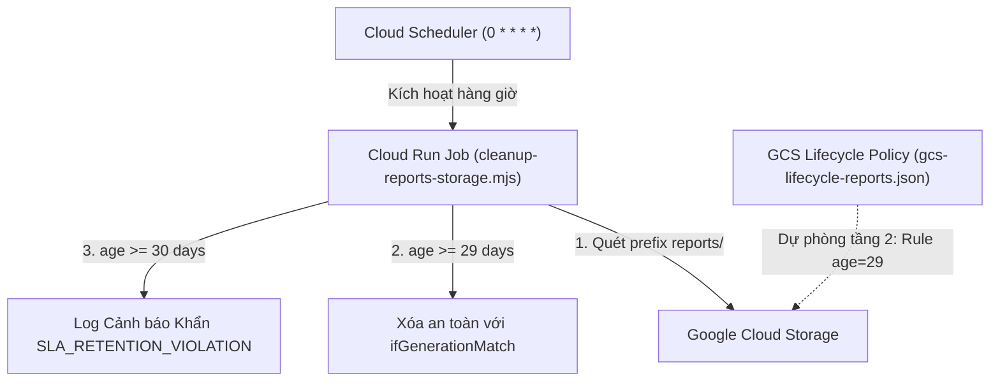

# RUNBOOK: VẬN HÀNH & TRIỂN KHAI WORKER DỌN RÁC STORAGE

Tài liệu hướng dẫn vận hành cho hệ thống dọn dẹp ảnh chụp màn hình báo cáo nộp trên Firebase Storage / Google Cloud Storage của 12Tester.

---

## 1. Mục tiêu & Chính sách lưu trữ

| Thành phần | Chính sách lưu trữ | Cơ chế dọn dẹp |
| :--- | :--- | :--- |
| **Screenshot báo cáo (`reports/*`)** | **Tối đa 30 ngày** kể từ `timeCreated` (UTC) | **Worker mỗi giờ** (bắt đầu dọn từ ngày **29** để có biên 1 ngày an toàn) + **GCS Lifecycle** dự phòng tầng 2. |
| **Icon ứng dụng (`app_icons/*`)** | **Vĩnh viễn** (hoặc theo vòng đời Campaign) | **Tuyệt đối không áp dụng thời hạn 30 ngày.** Cache-Control: `public, max-age=31536000, immutable`. |
| **Chiến dịch (`campaigns`)** | **90 ngày** sau khi hoàn thành | Lưu trữ trong Postgres DB, xử lý qua migration `041_campaign_retention.sql` và `043_backend_cleanup_hardening.sql`. |

---

## 2. Kiến trúc 2 tầng (Defense-in-depth)



1. **Tầng 1 (Chủ động):** Cloud Run Job chạy mỗi giờ kích hoạt bởi Cloud Scheduler (`0 * * * *`).
   - Lọc phân trang theo prefix `reports/`.
   - Bắt đầu dọn dẹp các object có tuổi $\ge 29$ ngày.
   - Gửi kèm `ifGenerationMatch: generation` để chống race condition.
   - Xử lý 404 idempotent (nếu file đã bị xóa).
   - Log có cấu trúc JSON cảnh báo vi phạm SLA nếu object đạt $\ge 30$ ngày.
2. **Tầng 2 (Bảo hiểm):** Object Lifecycle Management của GCS (`gcs-lifecycle-reports.json`).
   - Tự động xóa file sau 29 ngày phòng trường hợp worker bị ngắt quãng hoặc cấu hình sai.

---

## 3. Cấu hình Biến môi trường

| Tên biến | Bắt buộc | Mặc định | Ý nghĩa |
| :--- | :---: | :--- | :--- |
| `STORAGE_BUCKET` | Có | `cross-testers.firebasestorage.app` | Bucket mục tiêu. Worker sẽ từ chối chạy nếu bucket ngoài allowlist. |
| `TARGET_PREFIX` | Không | `reports/` | Prefix mục tiêu. Bắt buộc phải bắt đầu bằng `reports/`. |
| `TARGET_AGE_DAYS` | Không | `29` | Tuổi bắt đầu xóa (ngày). |
| `SLA_THRESHOLD_DAYS` | Không | `30` | Ngưỡng vi phạm SLA để kích hoạt cảnh báo (ngày). |
| `DRY_RUN` | Không | `false` | Nếu `true`, chỉ quét và thống kê số lượng/bytes mà không gửi lệnh xóa. |

---

## 4. Hướng dẫn Triển khai Cloud (Deploy Gate)

> [!IMPORTANT]
> Trong giai đoạn chuẩn bị hiện tại, các script đã được kiểm thử ở chế độ mô phỏng và unit test cục bộ.
> Khi nhận quyền triển khai trên môi trường thật, thực hiện theo các bước dưới đây.

### Bước 1: Kiểm thử cục bộ
```bash
cd backend/storage-cleanup
npm test
```

### Bước 2: Chạy thử ở chế độ Dry-run trên Cloud
```bash
# Thiết lập credential Google Cloud
export GOOGLE_APPLICATION_CREDENTIALS="/path/to/service-account.json"
export DRY_RUN="true"

node cleanup-reports-storage.mjs
```

### Bước 3: Triển khai tự động bằng Script
```bash
chmod +x setup-scheduler.sh
./setup-scheduler.sh
```

---

## 5. Giám sát & Cảnh báo (Monitoring & Alerting)

Cấu hình Google Cloud Logging Metric Filter và Alert Policy:

### 1. Cảnh báo Vi phạm SLA 30 ngày
- **Filter:** `jsonPayload.event = "SLA_RETENTION_VIOLATION"`
- **Severity:** `WARNING` hoặc `ERROR`
- **Ngưỡng:** $> 0$ trong 1 giờ.
- **Hành động:** Kiểm tra xem Cloud Run Job có bị timeout hoặc quota GCS có bị nghẽn không.

### 2. Cảnh báo Lỗi Xóa File
- **Filter:** `jsonPayload.event = "DELETE_FILE_ERROR"`
- **Severity:** `ERROR`
- **Ngưỡng:** $> 5$ trong 15 phút.

---

## 6. Xử lý Sự cố thường gặp

### Sự cố 1: `PRECONDITION_FAILED` (HTTP 412)
- **Hiện tượng:** Object generation đã thay đổi trong lúc worker đang xử lý.
- **Giải pháp:** Đây là hành vi an toàn theo thiết kế. Worker sẽ tự động bỏ qua object này để tránh xóa nhầm dữ liệu mới ghi đè.

### Sự cố 2: `Rate limit / Quota Exceeded` (HTTP 429)
- **Hiện tượng:** GCS trả về mã 429 do xóa quá nhiều object cùng lúc.
- **Giải pháp:** Worker đã tích hợp sẵn cơ chế Exponential Backoff với tối đa 3 lần thử lại. Nếu vẫn gặp lỗi, tăng giới hạn QPS của bucket trên GCP Console.

### Sự cố 3: Thao tác nhầm ngoài prefix `reports/`
- **Biện pháp phòng ngừa:** Worker tích hợp 2 lớp khóa cứng bảo vệ:
  1. Kiểm tra allowlist bucket `cross-testers.firebasestorage.app`.
  2. Khóa cứng prefix chỉ chấp nhận chuỗi bắt đầu bằng `reports/`. Mọi yêu cầu khác đều bị ném ngoại lệ `SECURITY ALERT` ngay lập tức.
